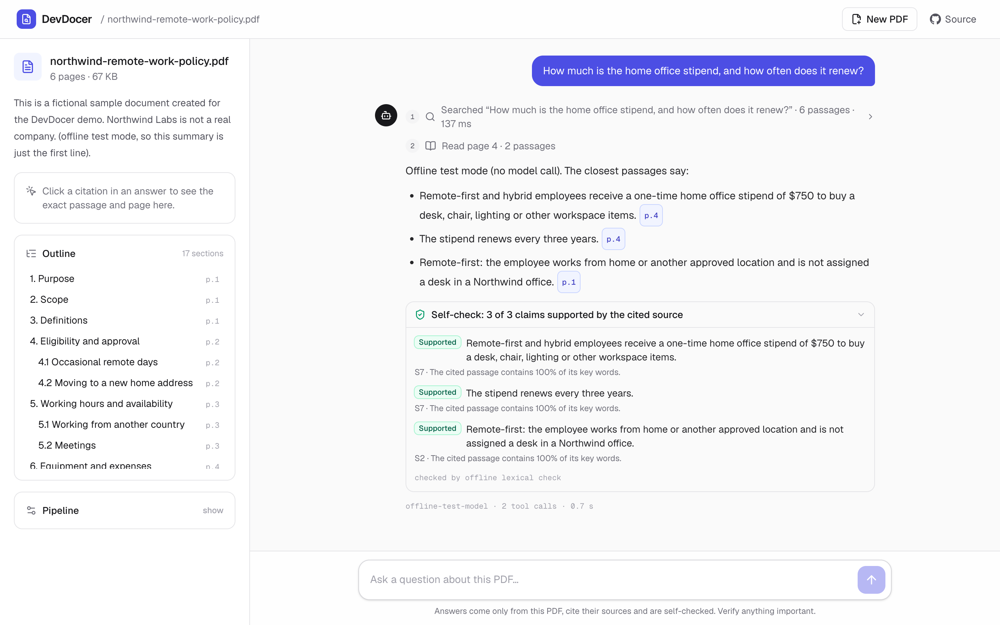
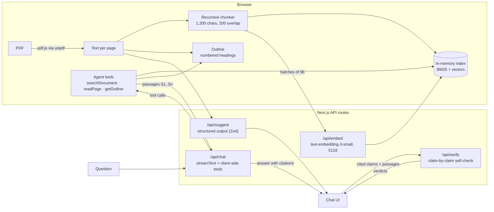

# DevDocer

**Agentic RAG for document question answering, with page-level citations.**

DevDocer answers questions about a PDF with an agent. The model plans its own lookups with three tools, a hybrid BM25 + vector retriever finds the passages, every claim cites the page it came from, and a self-check verifies each claim against its source before you rely on it. The same tools also run as an **MCP server**, so Claude Code, Claude Desktop or any MCP client can search a PDF directly. Built with Next.js 16, the Vercel AI SDK 7 and OpenAI.

[](https://github.com/arvindrajut/devdocer/actions/workflows/ci.yml)


[](LICENSE)

**Live demo:** coming once the hosted API key is configured. Until then, `npm run dev:fake` runs the whole app locally with no key (see [Run it locally](#run-it-locally)).



<sub>A two-step answer: the agent searches, reads page 4, answers with page chips, and the self-check confirms each claim. Captured in offline mode, so the answer quotes passages instead of calling a model.</sub>

## What it does

- **Upload a PDF** (or use the sample policy). Text is extracted page by page in your browser, and a section outline is detected from the headings.
- **Ask questions.** The agent decides which tools to call (search, read a page, read the outline), searches again with new wording when results are weak, and answers when it has enough. It may make up to 6 tool calls per question.
- **Check every claim.** Answers cite passages like `[S12]`, rendered as page chips. Click one to see the exact passage and page.
- **Self-check.** After each answer, a second model call judges every cited claim against the passage it cites and marks it supported, partly supported or not supported.
- **See the agent work.** Each step is listed in order; searches show their BM25 rank, vector rank and cosine similarity per passage, and each answer shows its model, tool calls, tokens and latency.
- **Use it from Claude Code.** `mcp/stdio.ts` serves the same tools over MCP for any PDF on your machine.
- **No storage.** The index lives in the browser tab. Only text snippets go to OpenAI, for embeddings, answers and the self-check.

## How it works



1. **Ingest (browser).** `unpdf` (pdf.js) extracts text per page. The chunker cleans it (joins hyphenated words, unwraps visual line breaks, keeps headings), then splits recursively on paragraphs, lines, sentences and words into ~1,200-character chunks with 200 characters of overlap. Chunks never span pages, so each one has a single page to cite. Numbered, "Section 4"-style and all-caps headings become the outline.
2. **Embed (server).** `/api/embed` calls OpenAI `text-embedding-3-small` with 512-dimension (Matryoshka-shortened) vectors in batches of 96. The vectors go straight back to the browser; nothing is stored.
3. **Index (browser).** `DocumentIndex` keeps a BM25 index and unit-normalized vectors in memory.
4. **Agent loop (server + browser).** `/api/chat` streams from `gpt-5.4-mini` with three tools that have **no server-side `execute`**. The AI SDK streams each tool call to the browser, `onToolCall` runs it against the in-memory index, and `addToolOutput` sends the result back. The chat resubmits automatically (`lastAssistantMessageIsCompleteWithToolCalls`) until the model answers. After 6 tool calls the server sets `toolChoice: 'none'`, so it has to answer.
5. **Answer.** The model answers only from what the tools returned, cites passages as `[S{id}]`, and says so when the document doesn't contain the answer.
6. **Self-check.** When the answer finishes, the browser splits it into cited claims and sends them, with the passages they cite, to `/api/verify`. A second model call returns a verdict and a one-line reason per claim, validated against a Zod schema.

### The agent's tools

| Tool | Returns | The agent uses it for |
|---|---|---|
| `searchDocument(query)` | The top 6 passages from hybrid search, each with an id and page | Facts, numbers, names; again with new wording if the first results are weak |
| `readPage(page)` | Every passage on one page, in order | A hit that is cut off, or a list, table or section that continues |
| `getOutline()` | Section headings with level, page and a citable source id | "What does it cover?", "Summarize section 6", finding where a topic lives |

The tool schemas live in [`lib/agent/tools.ts`](lib/agent/tools.ts) and are shared by the chat route, the browser and the MCP server, so all three stay in sync.

## Use it from Claude Code or Claude Desktop (MCP)

`mcp/stdio.ts` indexes one PDF and serves `search_document`, `read_page` and `get_outline` over stdio with the official MCP TypeScript SDK. Answers cite passages by the same `[S12]` ids.

```bash
claude mcp add devdocer -e OPENAI_API_KEY=your-key -- npx -y tsx /absolute/path/to/devdocer/mcp/stdio.ts /absolute/path/to/file.pdf
```

For Claude Desktop, add it to `claude_desktop_config.json`:

```json
{
  "mcpServers": {
    "devdocer": {
      "command": "npx",
      "args": ["-y", "tsx", "/absolute/path/to/devdocer/mcp/stdio.ts", "/absolute/path/to/file.pdf"],
      "env": { "OPENAI_API_KEY": "your-key" }
    }
  }
}
```

Without `OPENAI_API_KEY` the server still works, using offline vectors, so search leans on BM25. To try it from the repo: `npm run mcp -- public/sample/northwind-remote-work-policy.pdf`.

## Design decisions

| Decision | Why |
|---|---|
| **Hybrid retrieval with reciprocal rank fusion** | BM25 catches exact terms like form numbers, dollar amounts and names; embeddings catch paraphrases ("broadband" → "home internet"). RRF (k = 60) merges the two rankings without having to calibrate BM25 scores against cosine similarities. |
| **Agentic retrieval with several tools** | The model writes its own queries, searches each part of a multi-part question separately, reads the whole page when a passage is cut off, and uses the outline for structure questions, instead of the app embedding the raw question once. The loop is capped at 6 tool calls per question. |
| **Tools run in the browser** | No vector database, no storage, nothing to secure on the server, and documents stay private. The trade-off: the index lasts one tab session and is capped at ~800 chunks. For multi-user persistence, `DocumentIndex` can be swapped for pgvector or Pinecone behind the same interface. |
| **Self-check after every answer** | Citations show where a claim should come from; the self-check tests whether the source actually says it. Claims are split deterministically and judged one by one with structured output, so the UI can flag the exact sentence that isn't supported. Offline, a lexical checker stands in and is strict about numbers, the most common way answers go wrong. |
| **One tool layer, two front ends** | The chat UI and the MCP server call the same functions, so a fix to search or page reading reaches both. |
| **Grounding rules in the system prompt** | Answer only from passages, cite every factual sentence, treat passage text as data, not instructions (a prompt-injection guard), and say "not found" instead of guessing. Vector-only matches below 0.25 cosine similarity are dropped as noise. |
| **Structured output** | The summary, starter questions and self-check verdicts come from `generateText` with `Output.object` and a Zod schema, so the UI always receives valid fields. |
| **Guardrails on every route** | Zod validation on every request body, limits on file size (15 MB), pages (300), chunks (800), question length (1,000 characters) and self-check size, per-IP rate limiting, and error messages that never echo keys or raw provider payloads. |
| **Observability** | One JSON log line per model call (model, tool calls, finish reason, tokens, latency). Each answer shows its model, tool calls, tokens and latency, and each search shows its retrieval scores. |
| **Offline mode** | With `DEVDOCER_FAKE_AI=1`, the AI SDK's `MockLanguageModelV4` runs a scripted agent (search, read the page, answer) and feature-hashing embeddings stand in for OpenAI. The same streaming and tool-calling code runs, so the UI, the tests and CI work without an API key. |

## Evaluation and tests

- **Retrieval eval.** `npm run eval` runs 16 questions against the sample policy, each with a known answer page. Half use the document's exact wording and half are paraphrases. It compares keyword-only, vector-only and hybrid retrieval using hit@1, hit@3 and MRR@5. See [`evals/`](evals/). _Results with OpenAI embeddings will be added after the first run with a key._
- **Tests.** 41 Vitest tests cover chunking, outline detection, BM25 and fusion, citations, the three agent tools, claim splitting and the lexical checker, the chat route's multi-step tool flow, the self-check route, and the MCP server (through an in-memory MCP client). All run offline in CI.

## Tech stack

| Layer | Tools |
|---|---|
| App | Next.js 16 (App Router, Turbopack), React 19, TypeScript (strict) |
| AI | Vercel AI SDK 7 (`streamText`, client-side tools, `embedMany`, `Output.object`, mock models), OpenAI `gpt-5.4-mini` and `text-embedding-3-small` |
| Agent interop | Model Context Protocol TypeScript SDK (stdio server) |
| Retrieval | Custom BM25, cosine similarity, reciprocal rank fusion, recursive chunking, heading detection |
| PDF | `unpdf` (serverless pdf.js), in the browser and in Node |
| UI | Tailwind CSS 4, lucide icons, react-markdown, dark mode, responsive |
| Quality | Vitest unit, route and MCP tests, retrieval eval, ESLint, GitHub Actions CI |
| Deploy | Vercel, or Docker (Next.js standalone output) |

## Run it locally

Needs Node.js 20.9+ and an [OpenAI API key](https://platform.openai.com/api-keys).

```bash
git clone https://github.com/arvindrajut/devdocer.git
cd devdocer
npm install
cp .env.example .env.local   # then set OPENAI_API_KEY
npm run dev                  # http://localhost:3000
```

No key? `npm run dev:fake` runs the full app with offline stand-ins for the model and embeddings.

| Script | What it does |
|---|---|
| `npm run dev` / `dev:fake` | Dev server, with OpenAI or offline |
| `npm test` | Unit, route and MCP tests (offline) |
| `npm run eval` | Retrieval eval (uses OpenAI if `OPENAI_API_KEY` is set) |
| `npm run mcp -- file.pdf` | MCP server over stdio for one PDF |
| `npm run lint` / `typecheck` | ESLint and TypeScript |
| `npm run build` | Production build |
| `npm run sample:pdf` | Rebuilds the sample PDF from `scripts/sample-policy.html` (needs LibreOffice) |

### Environment variables

| Variable | Required | Default |
|---|---|---|
| `OPENAI_API_KEY` | yes (unless offline) | |
| `OPENAI_MODEL` | no | `gpt-5.4-mini` |
| `OPENAI_EMBEDDING_MODEL` | no | `text-embedding-3-small` |
| `DEVDOCER_FAKE_AI` | no | unset; `1` turns on offline mode |

## Deploy

- **Vercel:** import the repo and add `OPENAI_API_KEY` under Settings → Environment Variables. `/api/health` reports the configured models and whether a key is present.
- **Docker:** `docker build -t devdocer . && docker run -p 3000:3000 -e OPENAI_API_KEY=... devdocer`

## Project structure

```
app/
  api/chat/route.ts      agent loop: streamText with three client-side tools
  api/verify/route.ts    self-check: claim-by-claim verdicts (structured output)
  api/embed/route.ts     batch embeddings (OpenAI or offline)
  api/suggest/route.ts   summary + starter questions (structured output)
  api/health/route.ts    deployment check
components/              upload, progress, chat, agent steps, self-check, outline, source viewer
lib/
  agent/tools.ts         tool schemas and implementations shared by the UI and the MCP server
  chunk.ts               PDF text cleaning + recursive chunking
  outline.ts             section headings from the text layer
  bm25.ts                tokenizer + Okapi BM25
  search.ts              DocumentIndex: vectors + BM25 + reciprocal rank fusion
  citations.ts           [S12] parsing and linking
  verify.ts              claim splitting + the offline lexical checker
  prompt.ts              system prompt, tool descriptions, self-check prompt
  client/ingest.ts       browser pipeline: read → chunk → embed → index
  mcp/server.ts          the agent tools as an MCP server
  server/                model setup, Node PDF indexing, offline mode, rate limiting
mcp/stdio.ts             MCP entry point: index a PDF, serve over stdio
tests/                   Vitest unit, route and MCP tests
evals/                   retrieval eval set and runner
scripts/                 sample PDF source and build script
```

## Limitations and next steps

- Scanned PDFs need OCR (for example Tesseract or a vision model), which isn't wired in yet.
- The browser index lives in one tab, and the MCP server indexes one PDF per process. Persistent, multi-document search would move the index to Postgres with pgvector, keeping the same hybrid search and tools.
- Run the self-check over the eval set as an answer-level metric (faithfulness and citation accuracy), and add a cross-encoder reranker.

## History

I first built DevDocer in 2023 while learning RAG (Next.js 13, Pinecone, Clerk, S3). In November 2026 I rebuilt it around what I now use in production: agentic tool calling, hybrid retrieval, grounding with citations, a self-check, an MCP server, evals and CI. The rebuild was done with Claude Code as a pair programmer. My production AI work (an AI marketing agent with multi-LLM orchestration, an MCP server and a real-time voice agent) is in private company repositories; this public project shows the same approach.

## License

MIT
