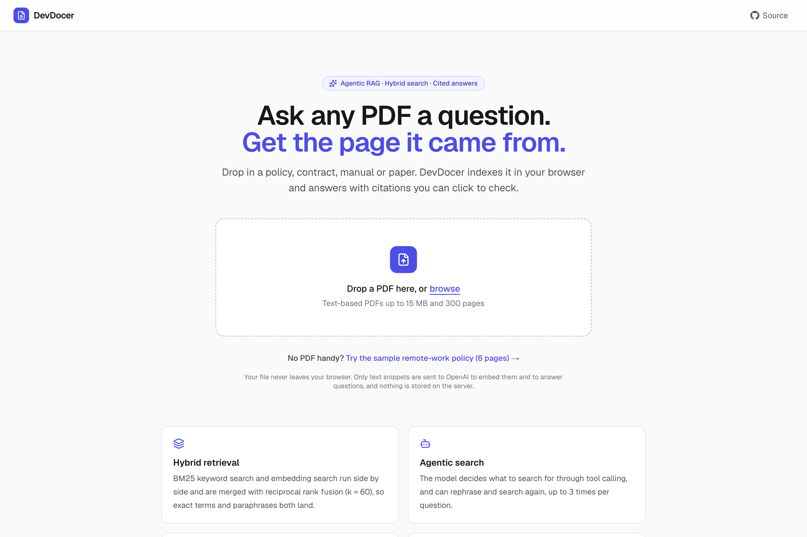
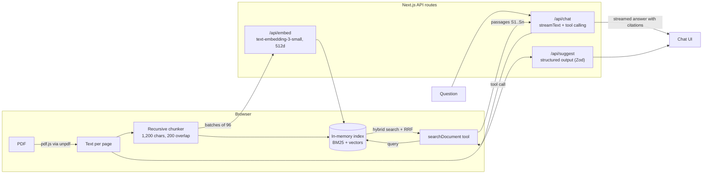

# DevDocer

**Chat with any PDF, and get answers that cite the page they came from.**

DevDocer is an agentic RAG app: the model decides what to search for, a hybrid BM25 + vector retriever finds the passages, and every claim in the answer links back to its source. Built with Next.js 16, the Vercel AI SDK 7 and OpenAI.

[](https://github.com/arvindrajut/devdocer/actions/workflows/ci.yml)


[](LICENSE)

**Live demo:** _coming with the first deployment_ · try it with the built-in sample PDF, no upload needed.



## What it does

- **Upload a PDF** (or use the sample policy). Text is extracted page by page in your browser.
- **Ask questions.** The model calls a `searchDocument` tool, reads the passages, and can rephrase and search again (up to 3 times) before answering.
- **Check every claim.** Answers cite passages like `[S12]`, rendered as page chips. Click one to see the exact passage and page.
- **See the retrieval.** Each search shows its BM25 rank, vector rank and cosine similarity per passage, plus model, token and latency stats per answer.
- **No storage.** The index lives in the browser tab. Only text snippets go to OpenAI, for embeddings and answers.

## How it works



1. **Ingest (browser).** `unpdf` (pdf.js) extracts text per page. The chunker cleans it (joins hyphenated words, unwraps visual line breaks, keeps headings), then splits recursively on paragraphs, lines, sentences and words into ~1,200-character chunks with 200 characters of overlap. Chunks never span pages, so each one has a single page to cite.
2. **Embed (server).** `/api/embed` calls OpenAI `text-embedding-3-small` with 512-dimension (Matryoshka-shortened) vectors in batches of 96. The vectors go straight back to the browser; nothing is stored.
3. **Index (browser).** `DocumentIndex` keeps a BM25 index and unit-normalized vectors in memory.
4. **Chat (server + browser).** `/api/chat` streams from `gpt-5.4-mini` with one tool, `searchDocument`, which has **no server-side `execute`**. The AI SDK streams the tool call to the browser, `onToolCall` runs hybrid search locally, and `addToolOutput` sends the passages back. The chat then resubmits automatically (`lastAssistantMessageIsCompleteWithToolCalls`).
5. **Answer.** The model answers only from the passages, cites them as `[S{id}]`, and says so when the document doesn't contain the answer. After 3 searches the server sets `toolChoice: 'none'`, so it has to answer.

## Design decisions

| Decision | Why |
|---|---|
| **Hybrid retrieval with reciprocal rank fusion** | BM25 catches exact terms like form numbers, dollar amounts and names; embeddings catch paraphrases ("broadband" → "home internet"). RRF (k = 60) merges the two rankings without having to calibrate BM25 scores against cosine similarities. |
| **Agentic retrieval through tool calling** | The model writes its own search queries and can search again with different wording, instead of the app embedding the raw question once. The loop is capped at 3 searches per question. |
| **Retrieval runs in the browser** | No vector database, no storage, nothing to secure on the server, and documents stay private. The trade-off: the index lasts one tab session and is capped at ~800 chunks. For multi-user persistence, `DocumentIndex` can be swapped for pgvector or Pinecone behind the same interface. |
| **Grounding rules in the system prompt** | Answer only from passages, cite every factual sentence, treat passage text as data, not instructions (a prompt-injection guard), and say "not found" instead of guessing. Vector-only matches below 0.25 cosine similarity are dropped as noise. |
| **Structured output** | The summary and starter questions come from `generateText` with `Output.object` and a Zod schema, so the UI always receives valid fields. |
| **Guardrails on every route** | Zod validation on every request body, limits on file size (15 MB), pages (300), chunks (800) and question length (1,000 characters), per-IP rate limiting, and error messages that never echo keys or raw provider payloads. |
| **Observability** | One JSON log line per model call (model, searches, finish reason, tokens, latency). Each answer shows its model, search count, tokens and latency, and each search shows its retrieval scores. |
| **Offline mode** | With `DEVDOCER_FAKE_AI=1`, the AI SDK's `MockLanguageModelV4` and feature-hashing embeddings stand in for OpenAI. The same streaming and tool-calling code runs, so the UI, the tests and CI work without an API key. |

## Evaluation

`npm run eval` runs 16 questions against the sample policy, each with a known answer page. Half use the document's exact wording and half are paraphrases. It compares keyword-only, vector-only and hybrid retrieval using hit@1, hit@3 and MRR@5. See [`evals/`](evals/).

_Results with OpenAI embeddings will be added after the first run with a key._

## Tech stack

| Layer | Tools |
|---|---|
| App | Next.js 16 (App Router, Turbopack), React 19, TypeScript (strict) |
| AI | Vercel AI SDK 7 (`streamText`, client-side tools, `embedMany`, `Output.object`, mock models), OpenAI `gpt-5.4-mini` and `text-embedding-3-small` |
| Retrieval | Custom BM25, cosine similarity, reciprocal rank fusion, recursive chunking |
| PDF | `unpdf` (serverless pdf.js), runs in the browser |
| UI | Tailwind CSS 4, lucide icons, react-markdown, dark mode, responsive |
| Quality | Vitest unit and route tests, retrieval eval, ESLint, GitHub Actions CI |
| Deploy | Vercel, or Docker (Next.js standalone output) |

## Run it locally

Needs Node.js 20.9+ and an [OpenAI API key](https://platform.openai.com/api-keys).

```bash
git clone https://github.com/arvindrajut/devdocer.git
cd devdocer
npm install
cp .env.example .env.local   # then set OPENAI_API_KEY
npm run dev                  # http://localhost:3000
```

No key? `npm run dev:fake` runs the full app with offline stand-ins for the model and embeddings.

| Script | What it does |
|---|---|
| `npm run dev` / `dev:fake` | Dev server, with OpenAI or offline |
| `npm test` | Unit tests plus the chat route's tool-calling flow (offline) |
| `npm run eval` | Retrieval eval (uses OpenAI if `OPENAI_API_KEY` is set) |
| `npm run lint` / `typecheck` | ESLint and TypeScript |
| `npm run build` | Production build |
| `npm run sample:pdf` | Rebuilds the sample PDF from `scripts/sample-policy.html` (needs LibreOffice) |

### Environment variables

| Variable | Required | Default |
|---|---|---|
| `OPENAI_API_KEY` | yes (unless offline) | |
| `OPENAI_MODEL` | no | `gpt-5.4-mini` |
| `OPENAI_EMBEDDING_MODEL` | no | `text-embedding-3-small` |
| `DEVDOCER_FAKE_AI` | no | unset; `1` turns on offline mode |

## Deploy

- **Vercel:** import the repo and add `OPENAI_API_KEY` under Settings → Environment Variables. `/api/health` reports the configured models and whether a key is present.
- **Docker:** `docker build -t devdocer . && docker run -p 3000:3000 -e OPENAI_API_KEY=... devdocer`

## Project structure

```
app/
  api/chat/route.ts      agentic chat: streamText + client-side searchDocument tool
  api/embed/route.ts     batch embeddings (OpenAI or offline)
  api/suggest/route.ts   summary + starter questions (structured output)
  api/health/route.ts    deployment check
components/              upload, progress, chat, citations, source viewer
lib/
  chunk.ts               PDF text cleaning + recursive chunking
  bm25.ts                tokenizer + Okapi BM25
  search.ts              DocumentIndex: vectors + BM25 + reciprocal rank fusion
  citations.ts           [S12] parsing and linking
  prompt.ts              system prompt and grounding rules
  client/ingest.ts       browser pipeline: read → chunk → embed → index
  server/                model setup, offline mode, rate limiting
tests/                   Vitest unit and route tests
evals/                   retrieval eval set and runner
scripts/                 sample PDF source and build script
```

## Limitations and next steps

- Scanned PDFs need OCR (for example Tesseract or a vision model), which isn't wired in yet.
- The index lives in one browser tab. Persistent, shared documents would move it to Postgres with pgvector, keeping the same hybrid search.
- Add a cross-encoder reranker, and answer-level evals (faithfulness and citation accuracy with an LLM judge).

## History

I first built DevDocer in 2023 while learning RAG (Next.js 13, Pinecone, Clerk, S3). In November 2026 I rebuilt it around what I now use in production: agentic tool calling, hybrid retrieval, grounding with citations, evals and CI. The rebuild was done with Claude Code as a pair programmer. My production AI work (an AI marketing agent with multi-LLM orchestration, an MCP server and a real-time voice agent) is in private company repositories; this public project shows the same approach.

## License

MIT
